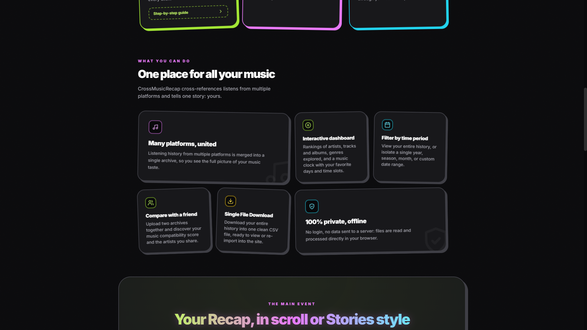
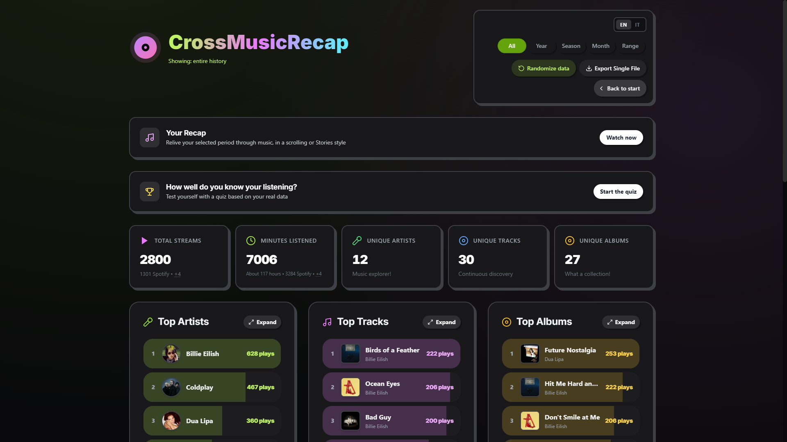
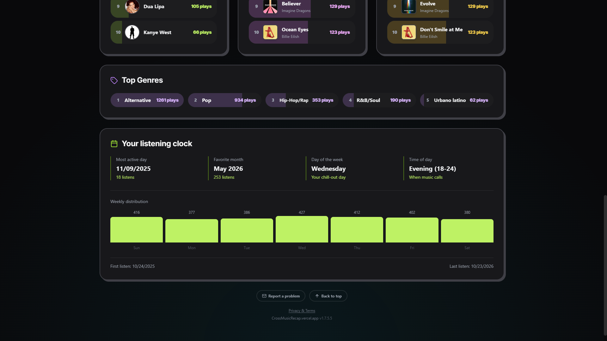
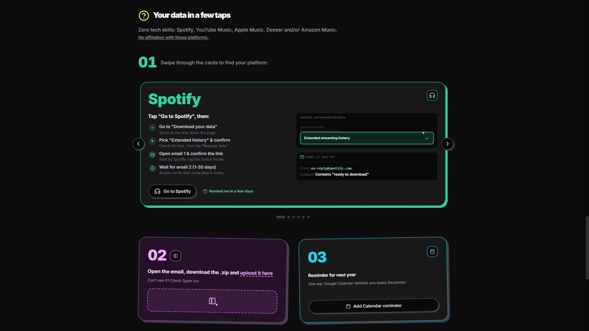
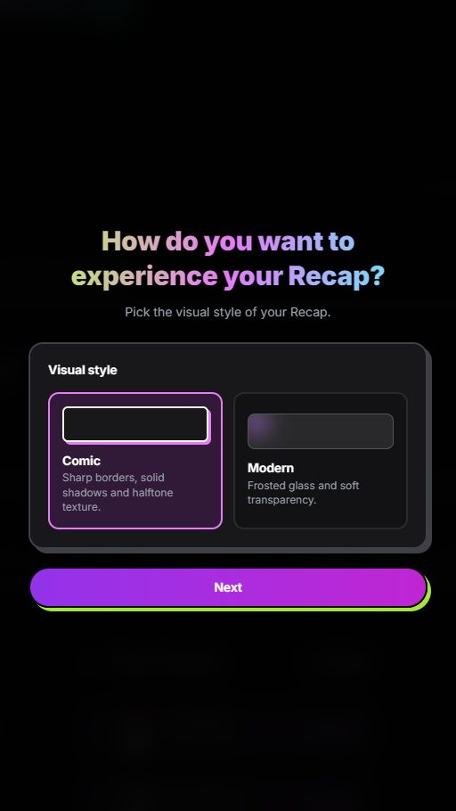
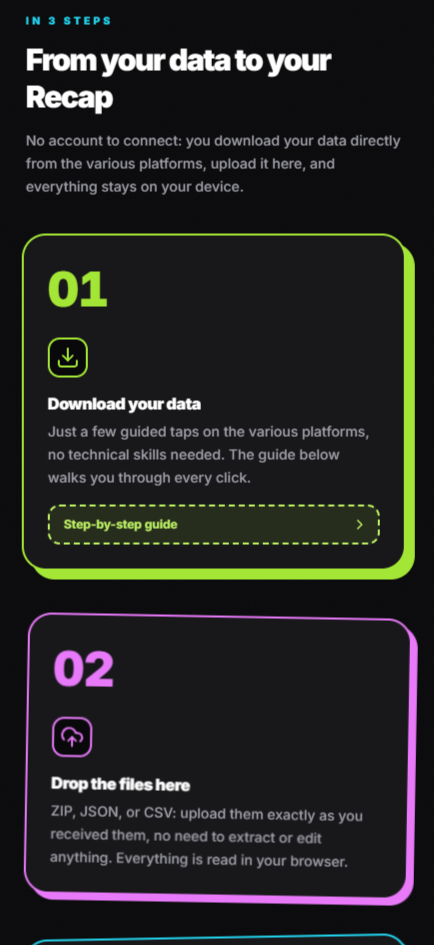
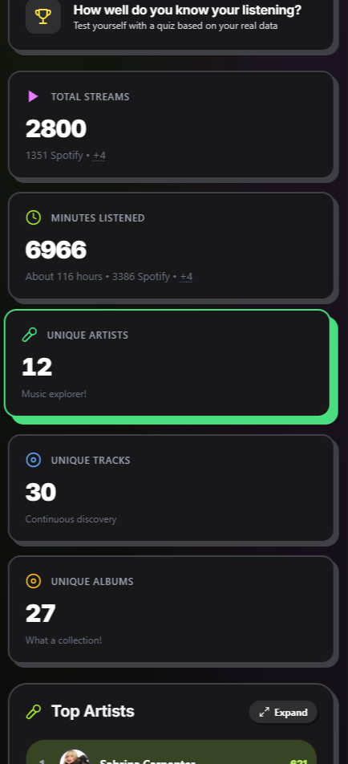

# CrossMusicRecap

Your music recap, from any platform.

🔗 **Try it live:** https://crossmusicrecap.vercel.app/

  
  
  
  

> **Note:** this repository is a showcase only. The source code is
> proprietary and is not published here.

## What it does

- **Dynamic backgrounds**: colors extracted from album covers and artist photos
- **Monthly Top 5 race**: an animated race showing how your favorite artists change month by month
- **Story-style slides**: top platform, top artist, big count-up numbers and more
- **Dashboard**: explore your listening data in detail
- **Customizable recap**: choose which contents to show and in which format
- **Step-by-step guides**: how to get your data from each platform
- **Mobile friendly**: a settings wizard designed for phones

## Screenshots

### Landing page

  

### Dashboard

  

  

### Guides

  

### Customize your recap

  
  
  
  

### On mobile

  
  

## How to use it

1. Open the site
2. Follow the guide to get your listening data
3. Load it into the dashboard
4. Customize your recap
5. Watch it and share it

## Project status

Under active development. Found a bug or have an idea?
Open an [issue](../../issues).

## License

Copyright © 2026 [Your Name]. All rights reserved.
This repository contains presentation material only. The source code
of CrossMusicRecap is not open-source and may not be copied, modified,
or redistributed without written permission.
