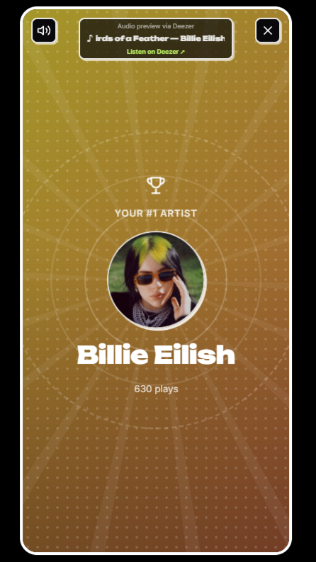
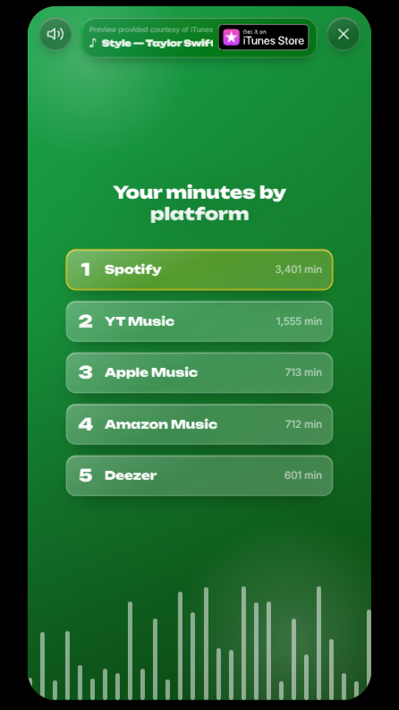
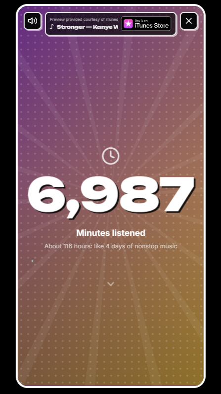
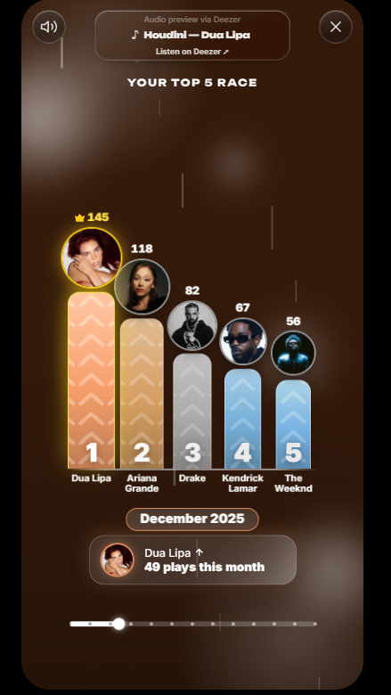
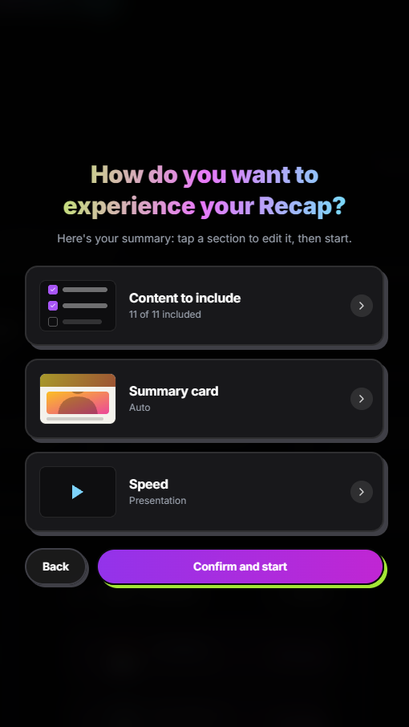
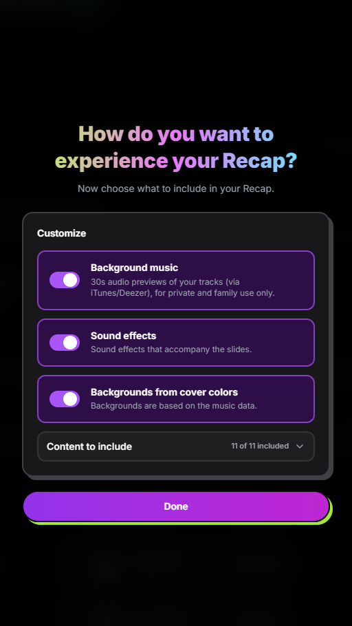
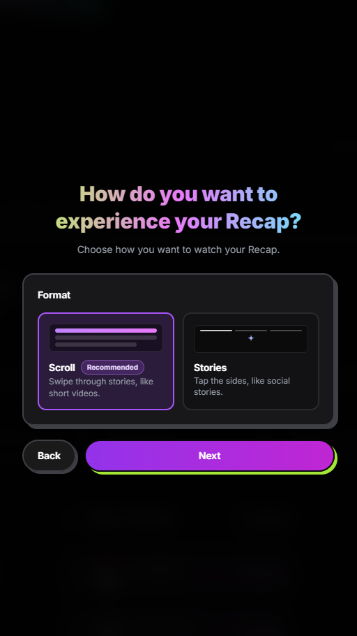

# CrossMusicRecap

Your music recap, from any platform.

🔗 **Try it live:** https://crossmusicrecap.vercel.app/

  
  
  
  

> **Note:** this repository is a showcase only. The source code is
> proprietary and is not published here.

## What it does

- **Dynamic backgrounds**: colors extracted from album covers and artist photos
- **Monthly Top 5 race**: an animated race showing how your favorite artists change month by month
- **Story-style slides**: top platform, top artist, big count-up numbers and more
- **Customizable recap**: choose which contents to show and in which format
- **Mobile friendly**: a settings wizard designed for phones

## Screenshots

  
  
  

## How to use it

1. Open the site
2. Load your listening data
3. Customize your recap
4. Watch it and share it

## Project status

Under active development. Found a bug or have an idea?
Open an [issue](../../issues).

## License

Copyright © 2026 [Your Name]. All rights reserved.
This repository contains presentation material only. The source code
of CrossMusicRecap is not open-source and may not be copied, modified,
or redistributed without written permission.
